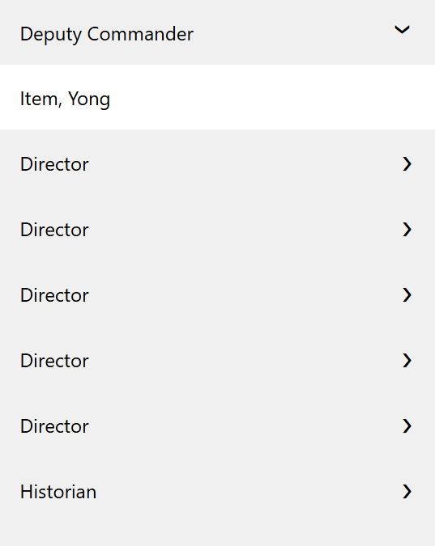

# SPS Accordion

SPFx 1.5.1 web part that renders SharePoint list items as collapsible accordion sections.

## Visual example



Turn a long list into scannable headings that visitors expand when needed. This
cropped directory example shows one heading's mapped content while keeping the
following entries compact. The same layout suits FAQs, procedures and reference pages.

Select `listName`, map `itemName` to the heading column and `itemContent` to the
body column, then choose single- or multiple-section behavior with `optionChoice`.
Header/content colors and typography can be styled separately.

This locally stored screenshot comes from an approved SharePoint Online demo;
it is not a SharePoint SE deployment verification.

## October 14, 2026 release

- npm version: `1.0.4`
- SharePoint solution and feature version: `1.0.0.22`
- Package: `sharepoint/solution/sps-accordion.sppkg`
- Adds **Manual styling**, **Site theme only**, and **Site theme with overrides**.
- Existing instances remain in Manual styling unless an author selects a theme mode.
- Site theme modes cover header, content, close-bar colors, and the shared font family without clearing saved manual values.

## Features

- Map list columns to accordion headers and HTML body content.
- Allow one open section at a time or multiple open sections.
- Customize header and content colors, fonts, and bold text.
- Load an optional override stylesheet.
- Enable diagnostic console logging.

## Configuration

| Property | Description |
|---|---|
| `appearanceMode` | Manual styling, site theme only, or site theme with non-empty manual color/font-family overrides. |
| `listName` | SharePoint list containing accordion items. |
| `itemName` | Column used as each section header. |
| `itemContent` | Column used as each section body. |
| `optionChoice` | Single-selection or multiple-selection accordion behavior. |
| `headerBackgroundColor` | Header background color. |
| `headerTextColor` | Header text color. |
| `headerFontBold` | Bold header text. |
| `contentBackgroundColor` | Expanded content background color. |
| `contentTextColor` | Expanded content text color. |
| `contentFontBold` | Bold content text. |
| `fontFamily` | Font family for headers and content. |
| `fontStyle` | Normal, italic, or oblique text. |
| `overrideCssUrl` | Optional external stylesheet loaded after component styles. |
| `enableDiagnostics` | Writes lifecycle and data-loading details to the browser console. |

## Build And Package

```powershell
npm install
gulp bundle --ship
gulp package-solution --ship
```

The deployable package is generated under `sharepoint/solution/`.

## Usage

1. Create or choose a SharePoint list with one column for section headings and one text or rich-text column for section content.
2. Add **SPS Accordion** to a modern page and open the property pane.
3. Select the list, map **Header** and **Content**, and choose single- or multiple-section behavior.
4. Configure header, content, corner, and optional close-bar styling, then publish the page.

## Properties and common configuration

- **Data:** `listName`, `itemName`, and `itemContent` identify the source and field mappings. Page visitors need read access to the list.
- **Behavior:** `optionChoice` allows one open section or multiple open sections. `showCloseBar` and the close-bar text/alignment properties provide a quick collapse action.
- **Appearance:** header/content colors, font sizes, bold settings, shared font family/style, and corner radius control the standard presentation.
- **Advanced:** `overrideCssUrl` loads an external stylesheet after component styles. Use `enableDiagnostics` when troubleshooting list or field discovery.

Rich text from the content field is rendered as accordion content, so only trusted authors should be allowed to maintain that column.

## Common scenarios

- Frequently asked questions with one question and answer per list item.
- Policy or procedure libraries grouped into compact expandable sections.
- Department directories where multiple teams can remain open for comparison.
- Long reference pages that need scannable headings without duplicating content in page markup.
