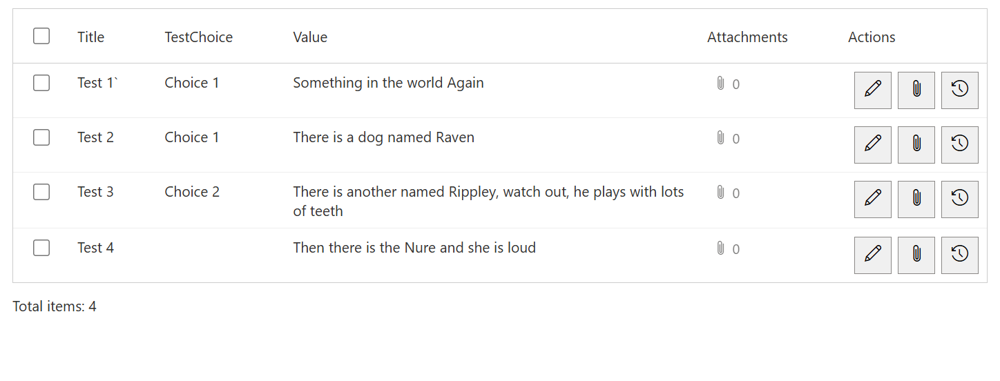

# GridControl

SPFx 1.5.1 editable SharePoint grid for SharePoint Server Subscription Edition.

## Designer grouped-view fix

Solution/feature `1.0.0.130` (npm `1.0.130`) fixes blank records after importing
columns/grouping from a grouped standard-list view, and restores Designer
grouping for document libraries. Runtime fetches real item rows rather than
SharePoint group summaries, then renders the saved grouping locally. Hidden
group keys are fetched, imported collapse settings are honored, and expanding
groups shows populated record cells. Filters, sort, scope, paging, drafts and
separate folder navigation remain.
See [deployment and acceptance checks](../README.md#grid-designer-grouped-view-fix).
No Designer re-save is required when the existing saved grouping is correct.

## Library selected-view fix

Solution/feature `1.0.0.107` (npm `1.0.107`) honors selected views' document
filters, ordering and folder/flat display when configured in settings or switched
at runtime. View columns apply unless an explicit Grid schema overrides them.
Flat views show matching documents across folders; folder-based views remain
scoped in folder-loading mode. Navigation folders are now separate from filtered
results under **Browse folders (navigation, not view results)**, not table rows.
Flat-view metadata reads only returned IDs with bounded concurrency. Grid drafts,
uploads and large-library safeguards remain. Selective indexed views can still
be necessary; paging does not bypass farm thresholds.
See [behavior, packages and acceptance checks](../README.md#library-selected-view-fix).
Earlier release descriptions below predate this correction.

## November 6, 2026 all-page-control navigation targets

Solution/feature `1.0.0.106` (npm `1.0.106`) broadens **Navigation target** to
identifiable built-in and third-party web parts and Text canvas controls on the
current page. Repository markers and Dynamic Data are not required. Standard
SharePoint metadata and legacy hosts provide stable instance IDs; accessible
labels, headings and short Text previews provide fallback names. Canvas/host
duplicates are collapsed while recognized previously saved IDs remain usable.
Deploy this package, reload and use **Refresh page controls**.
See [scope, limitations and acceptance checks](../README.md#november-6-2026-all-page-control-navigation-targets).

## November 5, 2026 large-library loading fix

Solution/feature `1.0.0.105` (npm `1.0.105`) adds **Buttons > Library loading**.
Choose **Folder-scoped paging (recommended for large libraries)** to avoid
recursively loading every document before browsing a folder. Server paging and
metadata requests stay within the current folder; counts exclude subfolders.
**Whole-library matching (recursive)** retains the previous complete hierarchy
and optional matching-folder pruning. Enabled matching remains recursive on
upgrade; explicitly choose folder mode for the reported large-library scenario.
Draft protection, uploads to the current folder and form connections are preserved.
Failures include the server response and correlation ID when available and do
not retry terminal HTTP errors with alternate JSON headers.
See [behavior, deployment and acceptance checks](../README.md#november-5-2026-large-library-loading-fix).

## November 5, 2026 page-name HTTP 406 fix

Solution/feature `1.0.0.104` (npm `1.0.104`) pairs the page-name request's verbose
JSON Accept header with `OData-Version: 3.0`. This prevents an incompatible
OData v4 request from blocking initialization of a new control. Naming and
failure handling are unchanged; navigation and Tab/theme fixes remain included.
See [deployment and acceptance checks](../README.md#november-5-2026-page-name-http-406-fix).

## November 5, 2026 navigation target discovery fix

Solution/feature `1.0.0.103` discovers all 18 updated repository page web parts
using stable host identities, including SPS Tabs without canvas-wrapper metadata.
Custom names and existing saved targets are preserved. Deploy the updated target
packages as well as GridControl; reload and use **Refresh page controls**.
See [versions and acceptance checks](../README.md#november-5-2026-navigation-target-discovery-fix).
Hidden targets still report an error; focusing Tabs does not switch its active tab.

## Visual example



Present list records in a compact table while keeping row-level actions beside
the data. This demo shows selection checkboxes, a choice column, wrapped text,
attachment counts, and edit, attachment and history commands.

Select the source list/view and use Grid Designer to choose column order, labels,
widths and editors. The grid supports inline row creation/editing and validation;
the screenshot shows the normal browsing state, not an item being saved.

This approved SharePoint Online demo is stored locally for documentation.
It is not SharePoint SE deployment verification.

## Matching document folders

Current release: npm `1.0.130`, solution/feature `1.0.0.130`.

**Web part name** defaults to `GridControl1`, `GridControl2`, etc. on the page.
It is the first editable setting, in **Web part** directly below the version banner.
Existing blanks are filled when editing; save the page to persist the name.
Custom names and GUID-based connections are preserved. See
[numbered naming behavior](../README.md#numbered-web-part-names).

Folder names and breadcrumbs are underlined navigation links, not command buttons.
Breadcrumbs use backslash separators, for example `Documents \ Team \ Reports`.
Folder navigation and the library root use SharePoint's built-in `folder.gif` image rather
than an outline font icon. Names remain visible with **Icon only** toolbar buttons.

- Document libraries always browse folders inside the control.
  **Buttons > Library loading** defaults to folder-scoped paging unless matching
  was already enabled. Folder mode loads only the current folder unless the selected
  view explicitly includes descendants. Accessible immediate children, including
  empty folders, remain in separate navigation. Whole-library mode recursively loads
  source-view documents; only that mode supports **Matching document folders**
  pruning. Selecting folder mode disables pruning. Select whole-library mode with
  pruning off to retain the previous unpruned recursive behavior. Standard lists
  are unchanged.
- The configured/default source view retains its document restrictions and ordering,
  and folder/flat display. Flat views retain recursive scope and show all matching
  descendants of the browsed folder together. Use an unfiltered source view
  when the control should own filtering; excluded documents cannot be restored later.
- Use the existing filter builder, for example:

  | Field | Operator | Value type | Value | Logical |
  | --- | --- | --- | --- | --- |
  | Modified | Greater than or equal | Expression | `now(-24h)` | First |
  | Modified | Less than or equal | Expression | `now` | AND |

  No dedicated 24-hour option or injected filter exists. `now(nh)` accepts integer
  elapsed-hour offsets such as `now(-6h)` and `now(-48h)`. Both inclusive bounds use
  one refresh instant across all pages. `date(-1)` remains yesterday's local calendar
  date. Created/Modified are filterable without becoming editable. Other filters,
  including Choice/Lookup multi-selection, determine document matches.
- With pruning on, only branches with matching descendants appear; the folder's own Modified value
  does not matter. Folder links always show icons and support keyboard activation.
  Breadcrumbs and Up provide drill-down navigation. Grid Designer grouping applies
  to matching document rows within the selected folder/flat scope, never to the
  separate navigation folders. Use **Load columns/grouping from view** in the
  Designer to import source grouping. Hidden group keys need not be visible columns.
- Folders have no edit/history/delete/Go-to-details actions and never publish their
  IDs to forms. Explicit folder navigation clears active and bulk selection.
  Document selection, document links and **Go to details** remain distinct.
  **Show link to item** controls document links, which use actual file locations
  rather than a custom metadata target page.
- **Add document** uploads to the browsed folder (root when at root). Existing files
  are not overwritten. Metadata failures clean up only the newly uploaded file.
  Saves reload the filtered hierarchy; successfully uploaded files can be absent
  when they do not match the configured filters.
- Five-minute automatic refresh in page read mode and manual Refresh refetch all
  pages in the selected scope before replacing the snapshot. Inline drafts/saves defer refresh; folder,
  view and column-filter changes cannot discard a draft. Background refresh does
  not republish unchanged selection, change a connected form or move focus.
  A disappearing selection or folder is explained. Refresh failures retain the last
  complete snapshot with a visible error.
- In whole-library mode, the footer counts matching files in the current folder and all its subfolders,
  never navigation folders: two folders containing three matching files report **3 files**.
  The navigation count covers the whole library. For folder-based views in folder-scoped mode, both counts
  cover only matching files in the current folder, explicitly excluding subfolders;
  connected `searchResultCount` has the same current-folder scope. All pages in
  that scope complete before counts are committed. Flat-view counts explicitly include
  descendants of the browsed folder. Pagination uses only document results;
  folder navigation is separate and does not change file totals. Large individual folders
  and recursive queries can still need selective indexed source views/filters.
  Client-only filtering and smaller page sizes do not bypass thresholds. Failures
  show server response details/correlation IDs when available. No indexes, views,
  permissions or farm thresholds are changed.
- Run `node tests\libraryViews.test.js`, `node tests\libraryLarge.test.js`,
  `node tests\libraryFolders.test.js`, `node tests\libraryRuntime.test.js` and
  `node tests\controlMetadata.test.js`
  from the repository root. Actual SE-farm acceptance remains required for restricted
  folders, special-character paths, uploads and libraries exceeding 5,000 documents.

Redeploy [sps-grid-control.sppkg](sharepoint/solution/sps-grid-control.sppkg).

## Selected-row navigation

- npm version: `1.0.95`; SharePoint solution and feature version: `1.0.0.95`.
- Under **Navigation**, choose a **Navigation target** from the controls on this
  page, including identifiable Microsoft/third-party web parts and Text blocks,
  not only repository controls. **None - disabled** preserves existing behavior and adds no action column.
  **Refresh page controls** updates the picker after adding controls. Names include
  instance IDs to distinguish duplicate names; an unavailable saved target is
  retained until the author changes it.
- Clicking a row highlights it and publishes the selected item ID/mode for Dynamic
  Forms. Bulk-delete checkboxes are a separate selection and do not choose the
  form's active item. Configure the form's Dynamic Data source separately.
- A **Go to details** button appears only on the active row, with its column space
  reserved. Only that button scrolls and moves keyboard focus; normal/repeated
  row clicks and text selection never navigate. Navigation does not republish the
  item, change View/Edit mode, save, or cancel anything.
- For several forms organized by SPS Tabs, choose the Tab control: navigation
  focuses its tab strip and preserves the active tab. A direct form target receives
  focus on its container, not its first input. Hidden/missing targets show an error
  on the selected row; navigation never automatically switches tabs.
- **Go to details** is disabled while an inline edit or new row is open; save or
  cancel first. Read-only grids can still navigate. Editing rows, bulk selection,
  grouping, and existing row-action positions retain their layouts.
- The action follows the existing text/icon button display mode. With navigation
  enabled, keyboard users can Tab to a row, press Enter/Space to select it, then
  Tab to **Go to details**.
- Redeploy [sps-grid-control.sppkg](sharepoint/solution/sps-grid-control.sppkg).
  Run `node tests\rowNavigation.test.js` from the repository root.
  Automated tests use mocked SharePoint page hosts; target-farm acceptance remains
  required, including discovery of the actual page controls.

## Multi-select column filters

- npm version: `1.0.94`; SharePoint solution and feature version: `1.0.0.94`.
- In the end-user column-header filter popup, Choice/MultiChoice and
  Lookup/LookupMulti columns show a scrollable checkbox list. **Equals** matches
  any checked value; **Not equals** excludes every checked value. Filters on
  different columns still combine with AND.
- **Apply** commits the selections and resets paging. Reopening restores them;
  **Close** discards uncommitted changes. **Clear**, or applying no selections,
  removes only that column's filter.
- Options use current SharePoint metadata, not stale grid-editor choices.
  Lookups use IDs for matching and display the configured lookup field, including
  paged results. Loading and errors are shown; Apply is disabled until options
  load successfully. Text, numeric, date, Boolean, and Person filters retain their
  existing behavior. Property-pane rule designers and row editors are unchanged.
- Redeploy [sps-grid-control.sppkg](sharepoint/solution/sps-grid-control.sppkg).
  From the repository root, run `node tests\columnFilters.test.js`,
  `node tests\dateFilters.test.js`, and `node tests\controlMetadata.test.js`.
  Tests use mocked SharePoint responses; target-farm UI acceptance is still required.

## October 28, 2026 type-aware rule values

- npm version: `1.0.93`; SharePoint solution and feature version: `1.0.0.93`.
- Preset filters and conditional-style rules offer inputs based on the selected
  SharePoint column: choices, site people/groups, lookup items, dates, date/time,
  numbers/currency, and Yes/No. Other columns retain text entry.
- People and lookup options load automatically; selecting one fills the stored
  ID. Lookup labels use the column's configured target field, not always Title.
  Refresh reloads options, paged results are included, and failures are displayed.
- Static multi-value columns can pick one comparison value. Preset filters also
  retain the **Field value** multi-select for Choice, Lookup, and Person columns.
- Date-only rules match the whole selected local date; date/time rules compare
  precise times. Numeric equality compares values rather than decimal formatting.
- Manual values and expression mode remain available. Existing people/lookup
  display-text conditions continue to work alongside picker-selected IDs.
- Redeploy `sharepoint/solution/sps-grid-control.sppkg`. From the repository root,
  run `node tests\ruleValueDesigners.test.js` and `node tests\dateFilters.test.js`.
  Tests use mocked SharePoint responses; live property-pane validation is still required.

## October 28, 2026 choice rule designer fix

- npm version: `1.0.92`; SharePoint solution and feature version: `1.0.0.92`.
- Preset filters and conditional-style rules show **Select a choice** for static
  Choice/MultiChoice conditions without requiring a switch to **Field value**.
- Picking an option fills the existing value editor. Manual text remains
  available for partial matches, fill-in choices, and older saved values.
- Expression editors and the existing **Field value** multi-select are unchanged.
- Redeploy `sharepoint/solution/sps-grid-control.sppkg`. From the repository root,
  run `node tests\ruleValueDesigners.test.js` to verify both control designers.

## October 26, 2026 theme-loading fix

- npm version: `1.0.91`; SharePoint solution and feature version: `1.0.0.91`.
- Caches early theme notifications until the first normal render, rather than
  treating an existing DOM element as proof that initialization is complete.
- Later theme changes still refresh the grid. Dynamic Data connections, list
  initialization, and manual styling are unchanged.
- Redeploy `sharepoint/solution/sps-grid-control.sppkg`. Run
  `node tests\themeLifecycle.test.js` from the repository root.

## October 22, 2026 release

- npm version: `1.0.90`
- SharePoint solution and feature version: `1.0.0.90`
- Package: `sharepoint/solution/sps-grid-control.sppkg`
- Adds **Manual styling**, **Site theme only**, and **Site theme with overrides**.
- Existing instances remain in Manual styling unless an author selects a theme mode.
- Site theme modes cover table and web-part surfaces, text, headers, selected states, buttons, borders, alternate rows, and font families.
- SharePoint metadata requests now bypass reusable browser responses so refreshed pages receive current field definitions and Choice options.
- Runtime, designer, and property-pane GET requests now use the browser's `cache: 'no-store'` option as well as cache-control headers, including every JSON-format fallback.
- Current SharePoint Choice/MultiChoice options override old saved schema snapshots, including when all options are removed.
- Saved grid-schema columns take precedence over the original view-column snapshot and are explicitly requested in runtime CAML, including subsequent data batches.
- Single-date filtering preserves literal `YYYY-MM-DD` values instead of shifting them through UTC parsing. Date input clicks retain native focus and selection behavior.
- Date-filter calendar and month-navigation symbols are drawn locally so buttons remain visible when the page omits Fabric icon glyphs. Date inputs leave room for the calendar button inside the filter popup.

GridControl starts with the ListControl display, filtering, styling, and dynamic-data baseline, then adds inline row creation and editing. For a standard list, select **+ Add row** to insert a draft row. For a document library, select **Add document** and choose the file before entering its metadata. Use the row-level **Edit** button for an existing row. **Save** validates and creates or updates the SharePoint item; **Cancel** discards the draft.

## Purpose

- Connect to a SharePoint list
- Choose a SharePoint view
- Design, rename, resize, and reorder editable grid columns visually
- Render rows using the view output from `RenderListDataAsStream`
- Apply preset filters and conditional row or column styling
- Publish selected item ID and selected mode via Dynamic Data
- Add and edit SharePoint items directly in the grid
- Upload documents and edit their library metadata without creating fileless library rows
- Validate required fields and deterministic Dynamic Form field rules before saving
- Select multiple rows and delete them in one operation
- Restrict read access and add/edit/delete access by SharePoint group

## Conditional Formatting Timer

When conditional-style JSON is configured, GridControl reevaluates its row and column formatting every five minutes. This allows expressions such as `now` to move records between time-based formatting bands while the page remains open.

The timer:

- Renders the rows already held in the client-side cache; it does not reload the page or request the list data again.
- Starts only when conditional formatting is configured.
- Restarts its behavior when the conditional-style configuration changes.
- Stops when conditional formatting is removed or the web part is unmounted.

The five-minute interval affects only conditional-format evaluation. The Refresh command and normal paging/filtering behavior continue to control when SharePoint data itself is retrieved.

## Grid Designer

Select a SharePoint list in the web-part properties, then choose **Open Grid Designer**. The designer provides three working panes:

1. **Available SharePoint fields** lists fields that can be added to the grid.
2. **Grid Columns** controls displayed column order and selection. Add, move, or remove columns here.
3. **Column Settings** configures the selected column's label, description, editor, width, state, default, and validation.

Choose **Save Grid** to apply the design or **Cancel** to discard the current changes. Changing the selected list clears the saved design because SharePoint field identities are list-specific. Before a design is saved, GridControl uses fields from the selected SharePoint view as a display fallback.

Fields marked required by SharePoint remain required in Grid Designer. Their Required checkbox is read-only and cannot be cleared; GridControl also enforces the list requirement at runtime for older saved designs.

Field help is displayed on hover over the column header, cells, and editing control. The SharePoint list-column description takes precedence when present. The Grid Designer description is used only when the list column does not have a description.

The designer can configure:

- `fieldName`, `type`, `label`, and `description`
- Boolean `visible`, `required`, and `readOnly` values
- `defaultValue` and `requiredMessage`
- `gridWidth` using values such as `180px`, `20%`, or `12rem`
- `config.placeholder`, `maxLength`, `min`, `max`, `decimals`, and DateTime `displayFormat`
- Choice/MultiChoice options are displayed read-only from the current SharePoint list column; change them in SharePoint, not in the saved grid design.
- Type-aware field validation rules and Dynamic Form-compatible advanced expressions

GridControl stores the result internally as a SharePoint Dynamic Form-compatible `FormSchema`. It reads fields from `steps[].fields` and intentionally ignores form steps, containers, wizard behavior, and form layout. The stored schema remains compatible with configurations created before the visual designer was introduced; raw JSON is not exposed as a normal property-pane authoring surface.

Grid Designer exposes one **Read only** setting because read-only and disabled cells have the same result in an inline grid. Legacy schemas with `disabled: true` remain supported and are normalized to read-only when opened in Grid Designer.

### Refreshing list metadata and columns

After changing Choice or MultiChoice options in SharePoint, refresh the control
or reload the page. Runtime editors use the current column metadata instead
of the `config.choices` snapshot in an older saved schema. Opening Grid Designer
also refreshes that snapshot for display and subsequent saves. Republish is
not required for list metadata changes.

After adding a list column, add it in Grid Designer, save the grid, and publish
the page. The saved grid design controls displayed columns; an automatically
initialized `viewColumns` snapshot no longer removes newer schema columns.
The selected SharePoint view's filters, sorting, and scope are preserved.
New list fields are not automatically added to a configured layout.
Field-metadata request failures are shown as runtime errors rather than
silently falling back to stale saved options.

From the repository root, run the shared ListControl/GridControl regression tests:

```powershell
node tests\controlMetadata.test.js
```

These tests exercise mocked SharePoint responses with jsdom, covering metadata
refresh, saved schema precedence, configured column data, saving without
remounting, paging, cache options, and metadata errors. Live SharePoint
verification is still required.

## Single-date filtering

Open a date column's filter, enter or choose **Date**, leave **End date** blank,
and select **Apply**. This matches that complete calendar day, regardless of
the stored time. Entering an end date selects an inclusive range of days.
Plain `YYYY-MM-DD` field values retain their literal date; timestamps use the
browser's local calendar day.

Run the shared ListControl/GridControl date-filter tests from the repository root:

```powershell
node tests\dateFilters.test.js
```

The tests cover single days, optional ranges, daylight-saving boundaries,
UTC timestamps, literal dates, clearing/reopening filters, and native click
behavior using mocked controls and jsdom. They do not replace live SharePoint
verification.

## Editable Controls

### Document libraries

GridControl identifies document libraries using SharePoint's authoritative list `BaseType`. Only a document-library `BaseType` changes the Add command to a file upload; standard lists continue to show **Add row** even when they expose hidden file-related fields. In a document library, the Add command opens a file picker instead of creating an item directly through the list-items endpoint. The selected file is uploaded to the library root folder first, and the inline values are then saved to the uploaded document's list item. If the metadata update fails, GridControl attempts to remove the uploaded file so that a blank or partially-created row is not left behind.

The selected file name is shown in the draft row and can be changed before saving. Existing documents continue to use normal inline metadata editing. Standard SharePoint lists retain the existing **Add row** behavior.

| SharePoint/Dynamic Form type | Grid editor |
|---|---|
| Text / `text` | Single-line text input |
| Note / `multiline` | Resizable multiline text area, or a visual HTML editor when SharePoint Rich Text is enabled |
| Number, Currency, Integer / `number` | Numeric input with optional min, max, and decimal step |
| Boolean / `boolean` | Checkbox |
| Choice / `dropdown` | Single-select dropdown |
| MultiChoice / `multiselect` | Multi-select list |
| DateTime / `datetime` | Date, date-time, or time input |
| URL / `url` | URL input |

Grid Designer restricts the Cell control list according to the underlying SharePoint storage type. Text and Note columns can use text, multiline, or number controls; URL columns can use URL or text controls. Number, Currency, Integer, Boolean, Choice, MultiChoice, DateTime, Lookup, Person, Taxonomy, Image, and Attachment columns remain limited to their storage-compatible control family. Existing schemas containing an incompatible selection are normalized when opened, and runtime applies the same guard to older or manually edited schemas.

Read-only, hidden, computed, and unsupported complex fields do not receive an editor. Lookup and person fields use their dedicated selectors. Taxonomy, image, and attachment fields do not use inline cell editors; saved rows can add list attachments through the row-level paperclip action.

SharePoint Note columns configured for rich text use a visual editor with bold, italic, underline, lists, alignment, and clear-formatting controls. Existing HTML is rendered visually and preserved when saved instead of being exposed as tags. Rich and plain multiline editing surfaces can be resized horizontally and vertically.

## Validation

Simple validation options follow the selected control type:

- Text, multiline, and URL controls support minimum length, maximum length, and an optional regular-expression pattern.
- Number controls support minimum and maximum values.
- Required state and its message apply to all editable controls.
- Invalid regular expressions are shown in Grid Designer and prevent the design from being saved.

Advanced validation uses the same expression grammar and `advancedValidation` schema shape as SharePoint Dynamic Form. Rules can compare fields, target a specific cell message, or show a grid-level message. Supported operators are `==`, `!=`, `>`, `>=`, `<`, `<=`, `&&`, `||`, `!`, and parentheses. Supported functions are:

- `field("InternalName")`
- `today()` and `now()`
- `daysFromToday(n)`
- `isEmpty(value)` and `hasValue(value)`
- `between(value, minimum, maximum)`

GridControl also executes DForm-compatible field rule types `required`, `minLength`, `maxLength`, `min`, `max`, `pattern`, and `custom`, including `applyWhen` expressions. Invalid expressions and patterns fail validation visibly instead of being silently ignored.

## Display And Actions

- `pageSize` controls client-side pagination; `0` or blank uses Automatic (50), and the maximum is 100 rows per page.
- SharePoint rows are cached progressively using paged batches (500 by default, configurable from 100 to 2000). The next batch is prefetched near the cache boundary, page totals show `+` while more rows exist, and client-only filtering, sorting, or grouping completes the cache before totals become final.
- The interactive column header follows page scrolling while the grid is visible, stops at the bottom of the table, and keeps open filter dialogs anchored to their header buttons; horizontal scrolling remains synchronized with the columns.
- When the table is wider than its viewport, left/right navigation arrows appear on hover or keyboard focus and move with the visible portion of the grid.
- The view selector, Refresh, Add, Delete, and Link to Item controls can be shown or hidden independently.
- The row action column containing Edit, History, or Save/Cancel can be placed at the beginning or end of the data columns. Delete-selection checkboxes remain first when enabled.
- Runtime command buttons can display text, a standard SharePoint Fabric icon with text, or an icon only. Icon-only controls retain accessible labels and hover tooltips.
- Inline date-time and time editors use the web part's global clock setting and minute increment. The defaults are a 24-hour clock and 5-minute increments; supported increments are 1, 5, 10, and 15 minutes.
- When versioning is enabled for the selected SharePoint list, the optional row-level **History** button opens the default version-history page in a padded in-page dialog. The button is hidden when list versioning is off, and its property-pane option is disabled with an explanatory note. It remains available in read-only grids because viewing history does not mutate the item; SharePoint permissions still govern access to version details.
- Attachment columns display a clickable paperclip count. The attachment dialog lists files, previews supported browser formats, and provides an Open link. Users with mutation access can add one or more files to a saved row from its paperclip action; upload results refresh the count and dialog.
- Link to Item can navigate to the list's default display form or an `.aspx` page discovered from the current site's Site Pages and publishing Pages libraries. It passes the selected ID through a configurable query parameter and can optionally include a return URL. Previously saved custom target URLs remain available in the dropdown.
- Body, header, selected-row, alternating-row, table, button, and web-part-container styles are configurable in the property pane.
- Preset filters and conditional formatting rules can be built in their property-pane designers and stored as JSON. Conditional overrides include background, foreground, font, alignment, border color/type/thickness, and square or rounded corners with a configurable radius.
- Diagnostic logging can be enabled for data loading and runtime troubleshooting.
- The Security settings can restrict reading to one SharePoint group and mutations to another. Edit-group members automatically receive read access. Users without read access see no list data, while read-only users see the configured edit-denial message and no mutation controls. Blank group selections defer to normal SharePoint list permissions.
- Use a row's **Edit** button to edit it inline. Save and Cancel replace the row action while editing, and only one row can be edited at a time.
- Select rows with the checkbox column, or select all rows on the current page from the header, then choose **Delete selected**. Selections persist while paging; failed deletions remain selected for retry.

## Integration with SharePointDynamicForm

Bind the form web part's dynamic item ID setting to this web part's `Selected Item ID` dynamic property. Dynamic Form can use that value as the form item ID or assign it to a selected parent lookup column.

Bind Dynamic Form's dynamic mode setting to `Selected Mode` so adding, selecting, or editing a row switches the connected form to `new`, `view`, or `edit` mode. When the selected value creates or filters related records instead of opening the same SharePoint item directly, configure a supported writable target column in the form; lookup/person targets use the selected numeric item ID.

When embedded in Dynamic Forms, GridControl accepts a transient parent filter and new-row default without changing its saved web-part properties. Filter target columns are hydrated by item ID even when they are absent from the selected view, and remain hidden unless they were configured for display. On mount or remount, GridControl requests the current runtime configuration so its host can immediately restore the parent filter, default value, and mode-based read-only state.

## Commands

```powershell
npm install
gulp bundle --ship
gulp package-solution --ship
```

The deployable package is generated under `sharepoint/solution/`.

## Usage

1. Add **SPS Grid Control**, select a SharePoint list and view, and open **Grid Designer**.
2. Add and order fields, then configure each column's label, width, editor, visibility, required/read-only state, default, and validation.
3. Configure page size, filters, row actions, target-page behavior, and conditional styles.
4. Test add, edit, cancel, validation, and multi-row deletion with realistic field types and permissions before publishing.
5. Optionally connect the published selected item ID/mode to Dynamic Forms or Report Forms.

## Properties and common configuration

- **Data:** `listName`, `viewId`, and fallback `viewColumns` define the source and initial columns.
- **Selected views:** Grid Control executes the selected view's native CAML filter, sort, scope, and row limit first, then loads Grid Designer field values only for the item IDs returned by that view.
- **Grid design:** `gridSchemaJson` stores the visual designer output and is authoritative once saved. Use the designer for field compatibility and validation rather than hand-editing it.
- **Behavior:** `pageSize`, `fetchBatchSize`, view selector, refresh, add/delete/history, item links, filtering, and target-page properties control grid operation. Blank page size means Automatic (50); fetch batches default to 500.
- **Editors and validation:** text, multiline, number, Boolean, choice, multi-choice, date/time, URL, lookup, and person fields receive compatible controls; list-required fields remain required.
- **Appearance:** body/header/selected-row, borders, alternate rows, buttons, date/time formats, web-part surface, and conditional-rule designers control display.
- **Advanced:** `forceFullWidth` uses the available page width. Embedded runtime filters can use hidden support columns and recover their filter/default/read-only configuration after remounts. `enableDiagnostics` records metadata, REST fallback, mutation, and rendering details.

The current user needs SharePoint permissions for each enabled action. Unsupported custom field types can be displayed but should remain read-only.

## Common scenarios

- Inline maintenance of tasks, inventory, contacts, or issue records.
- Parent/child line-item editing inside Dynamic Forms after the parent item is saved.
- Bulk selection and deletion for a controlled operational list.
- Conditional highlighting of overdue, high-priority, invalid, or completed rows.
- A selector/editor paired with a read-only Report Form on the same page.
# Search Control integration

Grid Control publishes its instance, list, and typed field metadata as the `searchMetadata` SPFx Dynamic Data property. An SPS Search Control can select this instance and publish an addressed `searchState`; Grid Control applies that state through its existing client-side filter engine. Clearing or retargeting the Search Control removes only the filter owned by that Dynamic Data source.
