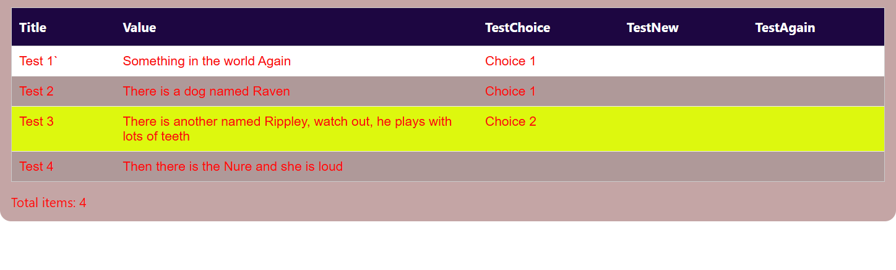

# ListControl

SPFx 1.5.1 list control web part for SharePoint Server Subscription Edition.

## Designer grouped-view fix

Solution/feature `1.0.0.130` (npm `1.0.130`) fixes blank records after importing
columns/grouping from a grouped standard-list view, and restores **List Designer**
grouping for document libraries. Runtime fetches real records instead of
SharePoint group summaries and applies saved grouping locally. Hidden grouping
fields are fetched across pages without becoming visible columns. One/two-level
groups, imported collapse settings and expanded populated rows are supported.
Source filters, sort, folder/flat scope, navigation, connected selection and
large-library safeguards remain. Correctly saved groups need no reimport.
See [deployment and acceptance checks](../README.md#list-designer-grouped-view-fix).

## Library selected-view fix

Solution/feature `1.0.0.129` (npm `1.0.129`) honors selected views' document
filters, ordering, columns and folder/flat display when configured in settings
or switched at runtime. Flat views show matching documents across folders;
folder-based views remain scoped in folder-loading mode. Navigation folders are
now separate from filtered results under **Browse folders (navigation, not view
results)**, not table rows. Flat-view metadata uses only returned IDs with bounded
concurrency, preserving the large-library protections. Selective indexed views
can still be necessary; paging does not bypass farm thresholds.
See [behavior, packages and acceptance checks](../README.md#library-selected-view-fix).
Earlier release descriptions below predate this correction.

## November 6, 2026 all-page-control navigation targets

Solution/feature `1.0.0.128` (npm `1.0.128`) broadens **Navigation target** to
identifiable built-in and third-party web parts and Text canvas controls on the
current page. Repository markers and Dynamic Data are not required. Standard
SharePoint metadata and legacy hosts provide stable instance IDs; accessible
labels, headings and short Text previews provide fallback names. Canvas/host
duplicates are collapsed while recognized previously saved IDs remain usable.
Deploy this package, reload and use **Refresh page controls**.
See [scope, limitations and acceptance checks](../README.md#november-6-2026-all-page-control-navigation-targets).

## November 5, 2026 large-library loading fix

Solution/feature `1.0.0.127` (npm `1.0.127`) adds **Buttons > Library loading**.
Choose **Folder-scoped paging (recommended for large libraries)** to avoid
recursively loading every document before browsing a folder. Server paging and
metadata requests stay within the current folder; counts exclude subfolders.
**Whole-library matching (recursive)** retains the previous complete hierarchy
and optional matching-folder pruning. Enabled matching remains recursive on
upgrade; explicitly choose folder mode for the reported large-library scenario.
Failures include the server response and correlation ID when available and do
not retry terminal HTTP errors with alternate JSON headers.
See [behavior, deployment and acceptance checks](../README.md#november-5-2026-large-library-loading-fix).

## November 5, 2026 page-name HTTP 406 fix

Solution/feature `1.0.0.126` (npm `1.0.126`) pairs the page-name request's verbose
JSON Accept header with `OData-Version: 3.0`. This prevents an incompatible
OData v4 request from blocking initialization of a new control. Naming and
failure handling are unchanged; navigation and Tab/theme fixes remain included.
See [deployment and acceptance checks](../README.md#november-5-2026-page-name-http-406-fix).

## November 5, 2026 navigation target discovery fix

Solution/feature `1.0.0.125` discovers all 18 updated repository page web parts
using stable host identities, including SPS Tabs without canvas-wrapper metadata.
Custom names and existing saved targets are preserved. Deploy the updated target
packages as well as ListControl; reload and use **Refresh page controls**.
See [versions and acceptance checks](../README.md#november-5-2026-navigation-target-discovery-fix).
Hidden targets still report an error; focusing Tabs does not switch its active tab.

## Visual example



Make selected columns easier to scan with custom headers, row colors and
conditional highlighting. This demo shows four list records, wrapped text,
a choice column and a highlighted row within a rounded outer surface.

Select the SharePoint list/view, configure `viewColumns`, and use the appearance
and conditional-style settings to control the presentation. ListControl can also
publish the selected item to Dynamic Forms or Report Forms for a master/detail page.
The image is cropped to the table; it does not show the command bar or filter popups.

This approved screenshot comes from a SharePoint Online demo and is stored locally.
It is not SharePoint SE deployment validation.

## Matching document folders

Current release: npm `1.0.130`, solution/feature `1.0.0.130`.

**Web part name** defaults to `ListControl1`, `ListControl2`, etc. on the page.
It is the first editable setting, in **Web part** directly below the version banner.
Existing blanks are filled when editing; save the page to persist the name.
Custom names and GUID-based connections are preserved. See
[numbered naming behavior](../README.md#numbered-web-part-names).

Folder names and breadcrumbs are underlined navigation links, not command buttons.
Breadcrumbs use backslash separators, for example `Documents \ Team \ Reports`.
Folder navigation and the library root use SharePoint's built-in `folder.gif` image rather
than an outline font icon. Names remain visible with **Icon only** toolbar buttons.

- Document libraries always browse folders inside the control, including when
  document links use **Dialog**. **Buttons > Library loading** defaults to
  folder-scoped paging unless matching was already enabled. Folder mode loads
  only the current folder unless the selected view explicitly includes descendants.
  Accessible immediate children, including empty folders, remain in separate navigation.
  Whole-library mode recursively loads source-view documents; only that
  mode supports **Matching document folders** pruning. Selecting folder mode
  disables pruning. Select whole-library mode with pruning off to retain the
  previous unpruned recursive behavior. Standard lists are unchanged.
- The configured/default source view keeps its document restrictions and ordering,
  and folder/flat display. Flat views retain recursive scope and show all matching
  descendants of the browsed folder together. Use an unfiltered source view if
  the control should own filtering; it cannot restore documents excluded by that view.
- Configure ordinary conditions in the existing filter builder. For example:

  | Field | Operator | Value type | Value | Logical |
  | --- | --- | --- | --- | --- |
  | Modified | Greater than or equal | Expression | `now(-24h)` | First |
  | Modified | Less than or equal | Expression | `now` | AND |

  There is no dedicated 24-hour option or injected date filter. `now(nh)` accepts
  integer elapsed-hour offsets, including `now(-6h)` and `now(-48h)`. One refresh
  instant is shared by both bounds and all pages; bounds above are inclusive.
  `date(-1)` still means yesterday's local calendar date, not elapsed 24 hours.
  Created/Modified are available in the filter builder. Non-date filters and
  Choice/Lookup multi-selection work too; no filters means all source-view documents.
- With pruning on, only branches containing matching documents appear. A folder's own date is
  irrelevant. Folder icons remain visible in every button mode. Open folders with
  their links; use breadcrumbs/Up to return. List Designer grouping applies to
  matching document rows within the selected folder/flat scope, never to the
  separate navigation folders. Use **Load columns/grouping from view** in List
  Designer to import source grouping. Hidden group keys need not be visible columns.
- Folder navigation clears document selection and publishes empty selection to
  connected forms. Document row selection, document links and **Go to details**
  remain separate actions. **Show link to item** controls document links, which open
  the actual file using the configured opening behavior, including **Dialog**.
  Subsite libraries are supported; custom metadata-page links are not used for libraries.
- Refresh runs every five minutes in page read mode, plus manual Refresh. It
  refetches all candidate pages in the selected scope and resolves accessible folders
  before replacing results. Failures retain the previous snapshot with an error.
  Background refresh preserves selection/form binding and focus. If a selected
  document disappears, a notice appears without choosing another document.
- In whole-library mode, the footer counts matching files in the current folder and all its subfolders,
  never navigation folders: two folders containing three matching files report **3 files**.
  The navigation count covers the whole library. For folder-based views in folder-scoped mode, both counts
  cover only matching files in the current folder, explicitly excluding subfolders;
  connected `searchResultCount` has the same current-folder scope. All pages in
  that scope complete before counts are committed. Flat-view counts explicitly include
  descendants of the browsed folder. Pagination uses only document results;
  folder navigation is separate and does not change file totals. Large individual folders
  and recursive queries can still need selective indexed source views/filters.
  Client-only filtering and smaller page sizes do not bypass thresholds. Failures
  show server response details/correlation IDs when available. No views, indexes,
  permissions or farm thresholds are modified.
- Regression commands from the repository root:
  `node tests\libraryViews.test.js`, `node tests\libraryLarge.test.js`,
  `node tests\libraryFolders.test.js`, `node tests\libraryRuntime.test.js` and
  `node tests\controlMetadata.test.js`.
  Local mocks do not replace acceptance on the target SE farm, including restricted
  folders, special-character paths and libraries exceeding 5,000 documents.

Redeploy [SPS-list-control.sppkg](sharepoint/solution/SPS-list-control.sppkg).

## Selected-row navigation

- npm version: `1.0.117`; SharePoint solution and feature version: `1.0.0.117`.
- Under **Navigation**, choose a **Navigation target** from the controls on this
  page, including identifiable Microsoft/third-party web parts and Text blocks,
  not only repository controls. **None - disabled** preserves existing behavior and adds no action column.
  **Refresh page controls** updates the picker after adding controls. Names include
  instance IDs to distinguish duplicate names; an unavailable saved target is
  retained until the author changes it.
- Selecting a row still highlights it and publishes its item ID/mode to connected
  forms, without moving focus. A **Go to details** button appears only on that row.
  Its space is reserved so selecting another row does not shift columns. Clicking
  the button moves keyboard focus and scrolls to the configured control without
  publishing another selection or changing View/Edit mode.
- For several forms organized by SPS Tabs, choose the Tab control: navigation
  focuses its tab strip and preserves the active tab. Direct form targets receive
  focus on their container, not an editable field. Hidden or missing targets show
  an error on the selected row; navigation never automatically switches tabs.
- Navigation does not configure the forms' item sources. Connect Dynamic Forms
  to this ListControl's selected item ID/mode separately. Text selection and
  repeated row clicks never navigate. With navigation enabled, keyboard users can
  Tab to a row, press Enter/Space to select it, then Tab to **Go to details**.
- The action follows the existing button display mode (text, icon/text, or icon).
- Redeploy [SPS-list-control.sppkg](sharepoint/solution/SPS-list-control.sppkg).
  Run `node tests\rowNavigation.test.js` from the repository root.
  Automated tests use mocked SharePoint page hosts; target-farm acceptance remains
  required, including discovery of the actual page controls.

## Multi-select column filters

- npm version: `1.0.116`; SharePoint solution and feature version: `1.0.0.116`.
- In the end-user column-header filter popup, Choice/MultiChoice and
  Lookup/LookupMulti columns show a scrollable checkbox list. **Equals** matches
  any checked value; **Not equals** excludes every checked value. Filters on
  different columns still combine with AND.
- **Apply** commits the selections and resets paging. Reopening restores them;
  **Close** discards uncommitted changes. **Clear**, or applying no selections,
  removes only that column's filter.
- Lookup options use IDs for matching, display the configured lookup field, and
  include paged results. Loading and errors are shown; Apply is disabled while
  lookup options are unavailable. Text, numeric, date, Boolean, and Person
  filters retain their existing behavior. Property-pane rule designers are unchanged.
- Redeploy [SPS-list-control.sppkg](sharepoint/solution/SPS-list-control.sppkg).
  From the repository root, run `node tests\columnFilters.test.js`,
  `node tests\dateFilters.test.js`, and `node tests\controlMetadata.test.js`.
  Tests use mocked SharePoint responses; target-farm UI acceptance is still required.

## October 28, 2026 type-aware rule values

- npm version: `1.0.115`; SharePoint solution and feature version: `1.0.0.115`.
- Preset filters and conditional-style rules offer inputs based on the selected
  SharePoint column: choices, site people/groups, lookup items, dates, date/time,
  numbers/currency, and Yes/No. Other columns retain text entry.
- People and lookup options load automatically; selecting one fills the stored
  ID. Lookup labels use the column's configured target field, not always Title.
  Refresh reloads options, paged results are included, and failures are displayed.
- Static multi-value columns can pick one comparison value. Preset filters also
  retain the **Field value** multi-select for Choice, Lookup, and Person columns.
- Date-only rules match the whole selected local date; date/time rules retain
  precise times. Numeric equality compares values rather than decimal formatting.
- Manual values and expression mode remain available. Existing people/lookup
  display-text conditions continue to work alongside picker-selected IDs.
- Redeploy `sharepoint/solution/SPS-list-control.sppkg`. From the repository root,
  run `node tests\ruleValueDesigners.test.js` and `node tests\dateFilters.test.js`.
  Tests use mocked SharePoint responses; live property-pane validation is still required.

## October 28, 2026 choice rule designer fix

- npm version: `1.0.114`; SharePoint solution and feature version: `1.0.0.114`.
- Preset filters and conditional-style rules show **Select a choice** for static
  Choice/MultiChoice conditions without requiring a switch to **Field value**.
- Picking an option fills the existing value editor. Manual text remains
  available for partial matches, fill-in choices, and older saved values.
- Expression editors and the existing **Field value** multi-select are unchanged.
- Redeploy `sharepoint/solution/SPS-list-control.sppkg`. From the repository root,
  run `node tests\ruleValueDesigners.test.js` to verify both control designers.

## October 22, 2026 release

- npm version: `1.0.113`
- SharePoint solution and feature version: `1.0.0.113`
- Package: `sharepoint/solution/SPS-list-control.sppkg`
- Adds **Manual styling**, **Site theme only**, and **Site theme with overrides**.
- Existing instances remain in Manual styling unless an author selects a theme mode.
- Site theme modes cover table and web-part surfaces, text, headers, selected states, buttons, borders, alternate rows, and font families.
- Configured columns are now requested even when they are outside the selected SharePoint view, and field metadata reloads when saved columns or grouping changes.
- SharePoint metadata requests bypass reusable browser responses so refreshed pages receive current field definitions and Choice options.
- Runtime, designer, and property-pane GET requests now use the browser's `cache: 'no-store'` option as well as cache-control headers, including every JSON-format fallback.
- Configured columns are included in the runtime CAML request even when no explicit SharePoint view is selected; the same request definition is retained for subsequent data batches.
- Date filters default to a single calendar day, including Date and Time columns. An optional end date selects an inclusive range; **Include time** preserves precise date/time filtering for Date and Time columns.
- Date-filter calendar and month-navigation symbols are drawn locally so buttons remain visible when the page omits Fabric icon glyphs. Date inputs leave room for the calendar button inside the filter popup.
- Caches early theme callbacks without mounting the control before initialization. Theme updates render normally after the first successful runtime or designer render. Initialization and render failures log the original error even when diagnostic logging is disabled.

## Purpose

- Connect to a SharePoint list
- Choose a SharePoint view
- Select, rename, resize, and reorder the displayed view columns
- Render rows using the view output from `RenderListDataAsStream`
- Apply preset filters and conditional row or column styling
- Publish selected item ID and selected mode via Dynamic Data
- Support `New`, `Edit`, `View`, and `Delete` actions

## Startup when embedded in Report Forms

SharePoint can supply the initial theme before web-part properties are available.
ListControl caches that theme and waits for SharePoint's first normal render
instead of trying to mount during the callback. Otherwise startup can fail before
`onInit`, leaving Report Forms unable to find the linked ListControl.

This fixes startup in ListControl itself; it does not change Report Forms'
embedding ownership or readiness-event behavior. If rendering still fails, the
browser console reports `[ListControlWebPart] Render failed.` with the original
error object. Rejected initialization also reports
`[ListControlWebPart] Initialization failed.`, including synchronous failures such
as Dynamic Data registration errors. Both messages are independent of the
**Enable diagnostic console logging** setting. Errors remain rejected or rethrown
so SharePoint still reports failure rather than treating the control as loaded.

From the repository root, run `node tests\themeLifecycle.test.js` and
`node tests\listControlHost.test.js` to verify startup lifecycle and embedding
regressions. Live SharePoint initialization and embedding still require validation.

## Conditional Formatting Timer

When conditional-style JSON is configured, ListControl reevaluates its row and column formatting every five minutes. This allows expressions such as `now` to move records between time-based formatting bands while the page remains open.

The timer:

- Renders the rows already held in the client-side cache; it does not reload the page or request the list data again.
- Starts only when conditional formatting is configured.
- Restarts its behavior when the conditional-style configuration changes.
- Stops when conditional formatting is removed or the web part is unmounted.

The five-minute interval affects only conditional-format evaluation. The Refresh command and normal paging/filtering behavior continue to control when SharePoint data itself is retrieved.

## View Columns

Selecting a list and view initializes the `viewColumns` collection from the SharePoint view's field order. Each row contains:

| Field | Description |
|---|---|
| `fieldName` | SharePoint internal field name used to read the value. |
| `displayName` | Column heading shown by ListControl. |
| `width` | Optional CSS width such as `180px`, `20%`, or `12rem`. Leave blank for automatic sizing. |

Use Move up and Move down in the collection editor to control display order. Changing the selected list or view clears and rebuilds the collection from that view, while later edits remain independent of SharePoint's view-column order.

If the collection is empty, ListControl falls back to the selected SharePoint view's fields and order.

### Refreshing list metadata

After changing Choice or MultiChoice options in SharePoint, refresh the control
or reload the page. Filter options are read from the current list field
definitions, including when choices are removed. Republish is not required
for list metadata changes.

After adding a list column, select it in List Designer, save the design, and
publish the page. The runtime requests the configured column's data rather than
relying on the original SharePoint view to include it. New list fields are not
automatically added to an intentionally configured column layout.

From the repository root, run the shared runtime/designer regression tests:

```powershell
node tests\controlMetadata.test.js
```

These tests exercise mocked SharePoint responses with jsdom, covering metadata
refresh, configured column data, saving without remounting, paging, and cache
options. Live SharePoint verification is still required.

Lookup values are normalized to their SharePoint display text. Object or JSON-shaped values containing `lookupValue`/`LookupValue` are shown as the readable lookup label rather than raw JSON.

Person/User columns, including **Modified By** (`Editor`) and **Created By** (`Author`), prefer the SharePoint display name or title across uppercase and lowercase response variants. Strict JSON, HTML-encoded JSON, and SharePoint Server's single-quoted serialized person payloads are normalized before display. Account name, email, and numeric ID are used only when no display label is available, preventing expanded user metadata from appearing in cells, sorting, grouping, or filters.

## Single-date filtering

Open a date column's filter, enter or choose **Date**, leave **End date** blank,
and select **Apply**. This matches that complete calendar day, regardless of
the stored time. Entering an end date selects an inclusive range of days.
Plain `YYYY-MM-DD` field values retain their literal date instead of being
shifted by UTC parsing; timestamps use the browser's local calendar day.

For Date and Time columns, select **Include time** to use precise date/time
inputs instead. Existing precise filters retain that mode when reopened.
Filter input clicks no longer cancel native input focus or selection behavior.

Run the shared date-filter tests from the repository root:

```powershell
node tests\dateFilters.test.js
```

The tests cover single days, optional ranges, daylight-saving boundaries,
UTC timestamps, literal dates, clearing/reopening filters, and native click
behavior using mocked controls and jsdom. They do not replace live SharePoint
verification.

## Display And Actions

- `pageSize` controls client-side pagination; `0` or blank uses Automatic (50), and the maximum is 100 rows per page.
- SharePoint rows are cached progressively using paged batches (500 by default, configurable from 100 to 2000). The next batch is prefetched near the cache boundary, page totals show `+` while more rows exist, and client-only filtering, sorting, or grouping completes the cache before totals become final.
- The interactive column header follows page scrolling while the list is visible, stops at the bottom of the table, and keeps open filter dialogs anchored to their header buttons; horizontal scrolling remains synchronized with the columns.
- Column filters use field-aware editors: choice and Boolean columns show fixed options, lookup and person columns load selectable values when opened, numeric columns use numeric inputs and comparison operators, and date/date-time columns support single-day matching and optional ranges.
- Date-time filter inputs use the global time format and minute increment. Time defaults to a 24-hour clock with 5-minute increments; supported increments are 1, 5, 10, and 15 minutes.
- When the table is wider than its viewport, left/right navigation arrows appear on hover or keyboard focus and move with the visible portion of the list.
- Group headers remain left-aligned at their configured nesting level when expanded or collapsed, independent of SharePoint host table-cell alignment styles.
- The view selector, Refresh, Add, Edit, View, Delete, and Link to Item controls can be shown or hidden independently.
- Attachment columns display a clickable paperclip count. The attachment dialog lists files, previews supported browser formats, and provides an Open link.
- Link to Item can navigate to the list's default display form or an `.aspx` page discovered from the current site's Site Pages and publishing Pages libraries. It passes the selected ID through a configurable query parameter, can optionally include a return URL, and can open in the same tab, a new tab, a sized new window, or a resizable in-page dialog. The dialog closes from its Close button or embedded callback; releasing a native resize handle does not dismiss it. Previously saved custom target URLs remain available in the dropdown.
- Body, header, selected-row, alternating-row, table, button, and web-part-container styles are configurable in the property pane.
- Preset filters and conditional formatting rules can be built in their property-pane designers and stored as JSON. Conditional overrides include background, foreground, font, alignment, border color/type/thickness, and square or rounded corners with a configurable radius.
- Diagnostic logging can be enabled for data loading and runtime troubleshooting.

## Integration with SharePointDynamicForm

Bind the form web part's dynamic item ID setting to this web part's `Selected Item ID` dynamic property. Dynamic Form can use that value as the form item ID or assign it to a selected parent lookup column.

Bind Dynamic Form's dynamic mode setting to `Selected Mode` so the Add, Edit, and View actions switch the connected form to `new`, `edit`, or `view` mode. When the selected value creates or filters related records instead of opening the same SharePoint item directly, configure a supported writable target column in the form; lookup/person targets use the selected numeric item ID.

When embedded in Report Forms, ListControl accepts a transient parent filter without changing its saved web-part properties. Filter target columns are hydrated by item ID even when they are absent from the selected view, and remain hidden unless they were configured for display. On mount or remount, ListControl requests the current runtime configuration so the host can immediately restore the filter.

## Commands

```powershell
npm install
gulp bundle --ship
gulp package-solution --ship
```

The deployable package is generated under `sharepoint/solution/`.

## Usage

1. Add **SPS List Control**, select the source list and default view, and review the generated view-column collection.
2. Reorder columns, rename labels, and assign widths only where automatic sizing is insufficient.
3. Configure page size, preset filters, visible actions, item links, and conditional styles.
4. Optionally connect the selected item ID and requested New/Edit/View mode to Dynamic Forms or Report Forms.
5. Test every visible action with representative users before publishing.

## Properties and common configuration

- **Data:** `instanceName`, `listName`, `viewId`, `viewColumns`, `pageSize`, and `fetchBatchSize` define the source, identity, columns, visible page size, and progressive SharePoint cache. Blank page size means Automatic (50); fetch batches default to 500.
- **Navigation:** view-selector, item-link, target-page, item-ID parameter, return-URL, and same-tab/new-tab/new-window/dialog target properties control how users move between views and records.
- **Actions:** refresh, add, edit, view, and delete toggles simplify the toolbar for the intended workflow; permissions still come from SharePoint.
- **Rules:** filter and conditional-style designers store JSON definitions with field operators, date/current-user expressions, and row/column scopes.
- **Appearance:** body/header/selected/alternate rows, table borders, web-part surface, buttons, typography, alignment, and date/time formats are configurable.
- **Advanced:** `forceFullWidth` expands the available workspace; embedded runtime filters can use hidden support columns and recover after remounts; `enableDiagnostics` logs list, view, filter, dynamic-data, and action details.

Selecting a different list or view can rebuild the column collection. Review custom labels, ordering, and widths after changing either source setting.

## Common scenarios

- A searchable operational list with only View and Refresh actions.
- A record selector that drives Dynamic Forms in New, Edit, or View mode.
- A dashboard table that highlights status, deadlines, ownership, or exceptions.
- A paged list linked to a custom details/report page through an item ID query parameter.
- A wide, read-only results table paired with Full Width Control.
# Search Control integration

List Control publishes its instance, list, and typed field metadata as the `searchMetadata` SPFx Dynamic Data property. An SPS Search Control can select this instance and publish an addressed `searchState`; List Control applies that state through its existing client-side filter engine. Clearing or retargeting the Search Control removes only the filter owned by that Dynamic Data source.
