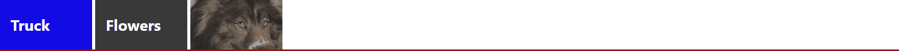
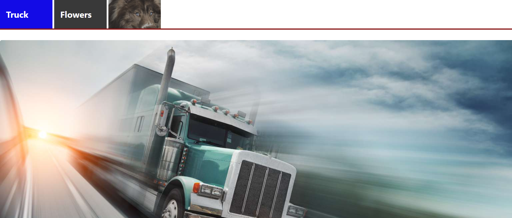
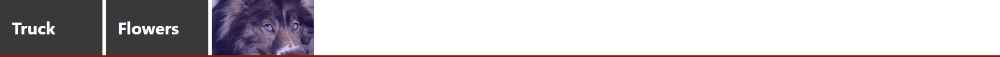

# SPS Tabs

SPFx 1.5.1 web part for grouping modern SharePoint page sections or individual web parts into a tabbed interface.

## November 5, 2026 navigation target discovery fix

Solution/feature `3.1.0.39` publishes Tab's stable instance GUID and web part title,
so List/Grid navigation pickers can list SPS Tabs even when SharePoint does not
expose its identity through canvas-wrapper metadata. Deploy with ListControl
`1.0.0.125` or GridControl `1.0.0.103`, reload and use **Refresh page controls**.
**Go to details** focuses the tab strip without changing the selected tab.
This release includes the loading fix below. See
[versions and acceptance checks](../README.md#november-5-2026-navigation-target-discovery-fix).

## November 5, 2026 Tab/forms loading fix

- Solution/feature version: `3.1.0.38`; npm remains `2.0.6`, SPFx remains `1.5.1`.
- The exclusion observer now refreshes Tabs only when an attribute mutation
  changes whether content is excluded, not when a form rewrites the same value.
- Deploy with Dynamic Forms `1.0.0.117` and Report Forms `1.0.0.88`, which also
  avoid unchanged exclusion writes and redundant activation renders.
- Both section-mode and web-part-mode Tabs retain their existing behavior,
  including lazy initialization of hidden forms and the theme-loading fix.
- See [regressions and deployment acceptance checks](../README.md#november-5-2026-tabforms-loading-fix).

## Visual examples

These screenshots show a configured SharePoint Online demo, not a SharePoint SE
deployment verification. They illustrate the tab presentation and content-grouping
features; the surrounding page content is supplied by other web parts. Screenshots
are stored in this repository so readers do not need access to the demo tenant.

### Text labels and an image-only tab



Mix descriptive labels with image-only navigation in the same strip. This example
uses bold white labels, contrasting active/inactive backgrounds, square tab corners,
and a separate red line beneath the strip.

To create a similar layout:

1. Add two entries in `collectionData` with `Title` values such as Truck and Flowers.
2. Add another entry with a meaningful `Title`, an `imageUrl`, and `onlyImage` enabled.
3. Configure `selectedColor`, `disableColor`, typography, and `tabShape` for the
   desired branding. Set `tabLineColor` and `tabLineWidth` independently.
4. Arrange the target sections or web parts in the same order as the tab entries.

### Selected content below the navigation



Use the tab strip to organize a page's existing content rather than placing all
content inside the tab label. Here, selecting Truck reveals its associated image
web part beneath the navigation. The same grouping pattern can organize dashboard,
list, or report areas.

Choose Sections or Web Parts mode with `TabType` to match the page layout, then
check each tab in read mode. The truck photograph is demo content, not a built-in
Tabs asset.

### Selecting an image-only tab



An image can act as the tab's visible label. Compare this selected state with the
first screenshot: the text tabs become inactive when the image-only tab is chosen.
Use `imagePosition` when combining images and text, or `onlyImage` when the image
should be the only visible label. `inactiveImageFade` controls inactive-image opacity.

## October 14, 2026 release

- npm version: `2.0.6`
- SharePoint solution and feature version: `3.1.0.36`
- Package: `sharepoint/solution/sps-tabs.sppkg`
- Adds **Manual styling**, **Site theme only**, and **Site theme with overrides**.
- Existing instances remain in Manual styling unless an author selects a theme mode.
- Site theme modes cover active and inactive tabs, text, borders, the tab strip, outer surfaces, and font family while preserving tab dimensions and layout.

## Features

- Build and reorder tabs in a property-pane collection editor.
- Target page sections or individual web parts.
- Configure each tab's title, text alignment, image, image position, and image-only mode.
- Customize tab shape, dimensions, typography, active/inactive colors, borders, and the tab-strip line.
- Fade images on inactive tabs without changing label or border opacity.
- Style the outer web-part border and corners independently from individual tabs.
- Automatically size tab widths or use a fixed width.
- Load an optional custom stylesheet.
- Keep all target content visible while the page is in edit mode.
- Ignore web parts or sections whose participating control enables **Exclude this web part from SPS Tabs**.
- Enable diagnostic console logging for zone discovery and configuration troubleshooting.

## Configuration

### Tabs

The `collectionData` editor defines tabs in display order. Use its Move up and Move down actions to change the order.

| Field | Description |
|---|---|
| `Title` | Required tab label. |
| `textPosition` | Label alignment: `left`, `center`, or `right`. |
| `imageUrl` | Optional image displayed in the tab. |
| `imagePosition` | Places the image to the `left` or `right` of the label. |
| `onlyImage` | Displays only the image and omits the text label. |

### Target And Appearance

| Property | Description | Default |
|---|---|---|
| `TabType` | `1` groups page sections; `2` groups individual web parts. | Sections (`1`) |
| `tabShape` | Rounded top corners or square corners. | `rounded` |
| `fontFamily` | Font family used by tab labels. | `Segoe UI` |
| `fontStyle` | Normal, italic, or oblique text. | `normal` |
| `isBold` | Uses bold tab labels. | Disabled |
| `fontSize` | Label size from 10 to 36 pixels. | `14` |
| `tabHeight` | Tab height from 36 to 160 pixels. | `60` |
| `autoTabWidth` | Sizes each tab from its content. Image-only tabs are always auto-sized. | Disabled |
| `tabWidth` | Fixed width from 60 to 400 pixels when auto sizing is disabled. | `120` |
| `selectedColor` | Active tab color, including optional alpha transparency. | `#8A1717` |
| `disableColor` | Inactive tab color, including optional alpha transparency. | `#393939` |
| `inactiveImageFade` | Percentage opacity reduction applied only to inactive tab images; active images remain fully opaque. | `45` |
| `tabBorderColor` | Border color for individual tabs. | `#000000` |
| `tabBorderWidth` | Individual tab border width from 0 to 20 pixels. | `0` |
| `tabBorderStyle` | Individual tab border type: none, solid, dashed, dotted, or double. | `solid` |
| `tabCornerRadius` | Rounded-tab corner radius from 0 to 40 pixels. | `10` |
| `tabLineColor` | Independent color of the line below the tab strip. | `#8A1717` |
| `tabLineWidth` | Tab-strip line width from 0 to 20 pixels. | `3` |
| `webPartBorderColor` | Border color for the outer web-part wrapper. | `#cccccc` |
| `webPartBorderWidth` | Outer wrapper border width from 0 to 20 pixels. | `0` |
| `webPartBorderStyle` | Outer wrapper border type: none, solid, dashed, dotted, or double. | `solid` |
| `webPartCornerStyle` | Uses square or rounded outer wrapper corners. | `square` |
| `webPartCornerRadius` | Outer wrapper radius from 0 to 40 pixels when rounded corners are selected. | `8` |
| `enableDiagnostics` | Writes tab discovery and configuration details to the browser console. | Enabled |

All tab-eligible SPS web parts expose `excludeFromTabs`, defaulted to disabled. In Web Parts mode, the marked web part is omitted. In Sections mode, a section containing a marked web part is omitted. Tabs observes late-rendering controls and refreshes discovery when the setting changes.

When a web part or section becomes excluded after initial tab discovery, Tabs releases it from tab management. The released zone is made visible, its loading state is removed, and any tab-owned content border or spacing variables are cleared. The same cleanup occurs when the Tabs web part is removed, preventing excluded or previously controlled content from retaining a hidden state.

### Custom CSS

- Set `overrideCSS` to the URL of a custom stylesheet, or
- Enable `useGlobalCSS` to load `/tabs/css/tabsoverride.css` from the web application root.

The global CSS option takes precedence over `overrideCSS`.

## Requirements

- SharePoint Server Subscription Edition
- SharePoint Framework 1.5.1
- A modern SharePoint page containing the sections or web parts to group
- Node.js 10.24.x and npm 6.x for local builds

## Build And Package

From the `Tab` folder:

```powershell
npm install
gulp bundle --ship
gulp package-solution --ship
```

The deployable package is generated under `sharepoint/solution/`.

## Disclaimer

This code is provided as-is without warranty of any kind, either express or implied.

## Usage

1. Add **SPS Tabs** before the content it will organize and choose Sections or Web Parts mode.
2. Add tab definitions in the same order as their target content, including optional images and text/image positioning.
3. Configure width strategy, height, shape, colors, typography, and inactive-image fade.
4. Verify every tab in edit and read modes; section targeting depends on the surrounding SharePoint canvas order.

## Properties and common configuration

- **Tabs:** `collectionData` stores ordered labels, alignment, image URLs/positions, and image-only choices.
- **Target:** `TabType` determines whether tabs control neighboring SharePoint sections or represent web-part content.
- **Layout:** auto width or fixed width, tab height, shape, border/line, and content spacing control the frame.
- **Appearance:** active/inactive colors, font settings, title, web-part border, and image fade control visual hierarchy.
- **Advanced:** external or global CSS options support shared branding. `forceFullWidth` expands the control, and `enableDiagnostics` logs target discovery and selection.

In Sections mode, tab order must match section order. Recheck the configuration after authors insert, remove, or rearrange page sections.

## Common scenarios

- Group dashboard sections into Overview, Metrics, Risks, and Actions tabs.
- Organize multiple list/report areas without forcing visitors down a long page.
- Build icon-assisted tabs for a project or department hub.
- Combine Tabs, Tiles, and Full Width Control for a wide portal navigation experience.
